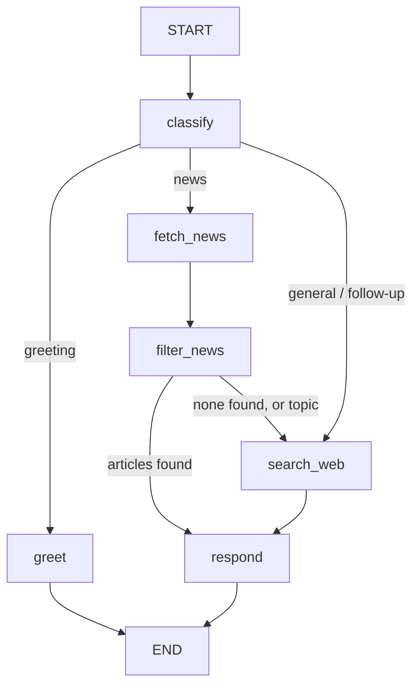

# NewsGenie

An AI-powered information and news assistant. NewsGenie answers general questions and delivers curated, real-time news in one chat interface. It routes every message through a LangGraph workflow, pulls headlines from a chain of news providers, scores each story for source reliability, and keeps conversation context so you can ask follow-ups like "tell me more about #2".

**Stack:** Python, LangGraph, LangChain + OpenAI, NewsAPI, GNews, DuckDuckGo (ddgs), Streamlit, pytest

## Features

- **Query differentiation.** A two-layer classifier (instant rules, then an LLM with structured output) sorts each message into greeting, category news, topic news, follow-up, or general question.
- **Real-time news with fallbacks.** Cache, then NewsAPI, then GNews, then DuckDuckGo News, then the last good cached result (clearly labeled as stale).
- **Misinformation filtering.** Transparent reliability score from source reputation, headline clickbait signals, and cross-outlet corroboration. Satire and low-credibility sources are hidden but viewable.
- **Web search grounding.** General answers cite live web results. Topic news gets related background links.
- **Conversation memory.** A LangGraph checkpointer stores chat history and the last article list per session.
- **Graceful degradation.** Runs with zero API keys (rule routing, template answers, DuckDuckGo). Every missing key and failed call is shown in a "Fallback details" panel instead of a crash.

## Project structure

```
newsgenie/
├── app.py                     # Streamlit UI (chat, category buttons, session, status)
├── newsgenie/
│   ├── config.py              # .env loading, key status, category map
│   ├── models.py              # Article / SearchResult shapes
│   ├── classifier.py          # rules + LLM query differentiation
│   ├── llm.py                 # OpenAI chat model (None when no key)
│   ├── responder.py           # LLM and template replies
│   ├── graph.py               # LangGraph workflow + checkpointer
│   └── tools/
│       ├── http.py            # requests session with retry/backoff
│       ├── cache.py           # TTL cache + last-good store
│       ├── news_api.py        # NewsAPI → GNews → DuckDuckGo → stale chain
│       ├── web_search.py      # DuckDuckGo web search
│       └── reliability.py     # source scoring and filtering
├── scripts/
│   ├── generate_samples.py    # writes docs/sample_outputs.md (tech, finance, sports)
│   └── export_graph.py        # writes docs/workflow.mmd
├── tests/                     # 28 offline tests (no network, no keys)
├── docs/
│   ├── REPORT.md              # submission report draft
│   ├── workflow.mmd           # LangGraph diagram (Mermaid)
│   └── failure_mode_demo.md   # output with every service unreachable
├── .streamlit/config.toml
├── .env.example
├── requirements.txt
└── README.md
```

## Setup

```bash
python3 -m venv .venv
source .venv/bin/activate
pip install -r requirements.txt
cp .env.example .env          # then add your keys
```

Keys (all optional, but you want at least OpenAI and NewsAPI for the full demo):

| Variable | Where to get it | Without it |
|---|---|---|
| `OPENAI_API_KEY` | platform.openai.com | rule-based routing, template answers |
| `NEWSAPI_KEY` | newsapi.org/register | falls back to GNews / DuckDuckGo |
| `GNEWS_API_KEY` | gnews.io | skipped in the chain |

## Run

```bash
streamlit run app.py          # opens http://localhost:8501
pytest -q                     # offline test suite
python scripts/generate_samples.py   # real sample outputs for the report
python scripts/export_graph.py       # workflow diagram
```

## How a message flows



See `docs/REPORT.md` for the design, error handling, and fallback details.
