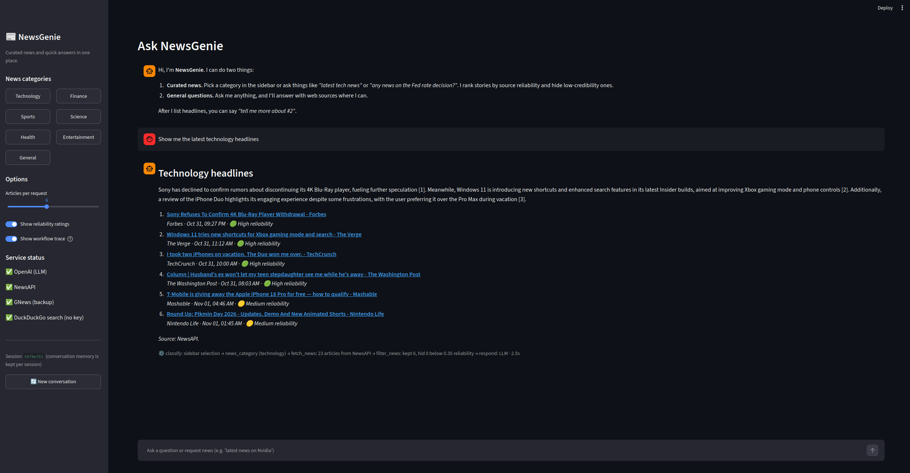
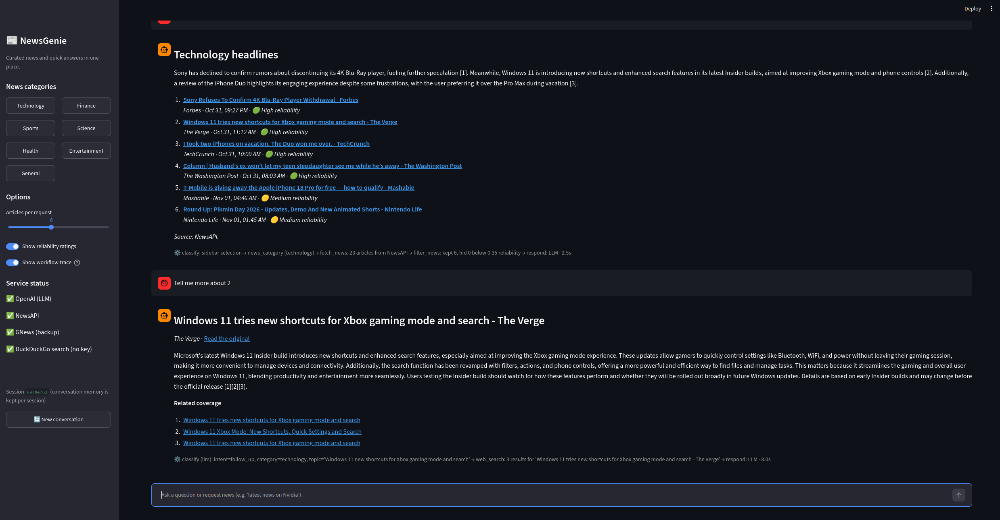
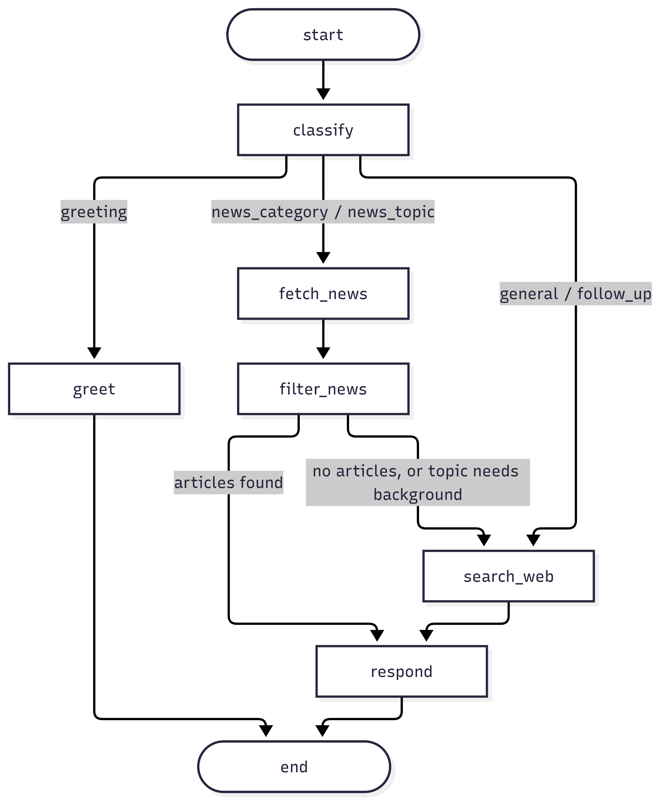
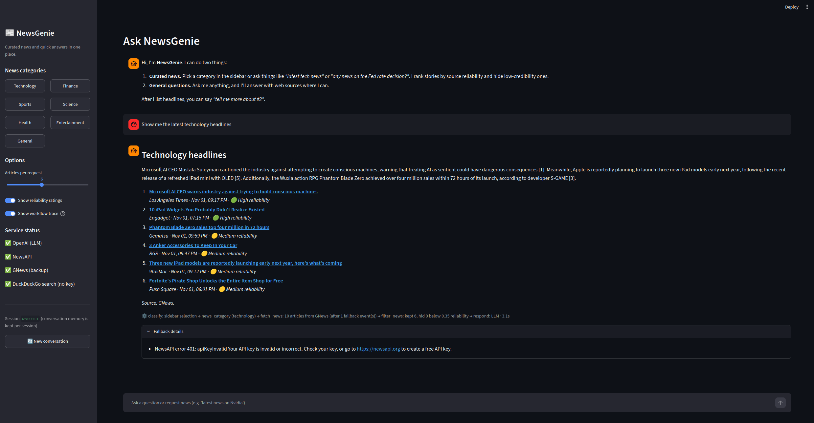

# NewsGenie: An AI-Powered Information and News Assistant

**Author:** Alessandra Hershey-Zagrans\
**Repository:** <https://github.com/Alessandrarye/newsgenie>

## 1. Problem and approach

News consumption is fragmented. People bounce between apps for headlines, a search engine for background, and a chatbot for quick answers, and none of them tell you much about whether a source is trustworthy. NewsGenie puts those jobs in one chat window. It answers general questions, delivers category or topic news on demand, rates each story's source reliability, and remembers the conversation so follow-ups work naturally.

The system has four layers:

<!-- prettier-ignore -->
| Layer         | Technology                 | Job                                                                 |
|--------------|----------------|--------------------------------------|
| Interface     | Streamlit                  | Chat, category buttons, options, service status, per-session memory |
| Orchestration | LangGraph                  | Routes each message through classify → retrieve → filter → respond  |
| Intelligence  | OpenAI via LangChain       | Intent classification (structured output) and grounded answers      |
| Data          | NewsAPI, GNews, DuckDuckGo | Real-time headlines and web search, in a fallback chain             |



Full source code, tests, and setup instructions are available at <https://github.com/Alessandrarye/newsgenie>.

## 2. AI chatbot design

### 2.1 Query differentiation

Every message is classified into one of five intents before any tool runs. Classification decides which APIs get called, so a general question never burns news API quota and a news request never gets a stale answer from the model's training data.

<!-- prettier-ignore -->
| Intent          | Example                                             | Route                                      |
|------------------|------------------------------|--------------------------|
| `greeting`      | "hi", "what can you do"                             | Canned help text, no tools                 |
| `news_category` | "latest tech news", sidebar button                  | News providers by category                 |
| `news_topic`    | "any news about Nvidia earnings?"                   | News providers by keyword + web background |
| `follow_up`     | "tell me more about #2"                             | Remembered article + web search            |
| `general`       | "what's the difference between a stock and a bond?" | Web search + LLM answer                    |

Classification runs in two layers:

1. **Rules (always on, instant).** Regular expressions catch greetings, follow-up references ("#2", "the second article"), and news cue words ("latest", "headlines", "breaking"). Keyword lists map words to categories (for example "stocks", "Fed", "earnings" → finance). After removing filler words, anything left over becomes the topic, so "latest news on the Fed rate cut" yields topic _Fed rate cut_.
2. **LLM with structured output (when a key is set).** For anything the rules did not settle, the model returns a typed `Classification` object (intent, category, topic, article index, standalone search query). It sees the last six messages, which lets it resolve references like "what about him?" into a full search query.

Greetings and follow-ups skip the LLM entirely because the rules handle them reliably. If the LLM call fails or returns something inconsistent (a follow-up when no articles exist), the rule result is used. The UI trace shows which method decided.

### 2.2 Conversation management

- **Session isolation.** Each browser session gets a UUID `thread_id`. The compiled graph is shared across sessions, but LangGraph's checkpointer stores state per thread, so conversations never mix.
- **What persists between turns.** `messages` (full chat history, appended through the `add_messages` reducer) and `last_articles` (the most recent ranked list, which makes "tell me more about #3" work).
- **What resets each turn.** Intent, retrieved articles, web results, errors, and the trace are cleared in the first node so nothing from the previous request leaks into the next.
- **Context window control.** The classifier sees the last 6 messages and the answer generator the last 8. That keeps latency and cost flat as conversations grow.
- **New conversation.** A sidebar button issues a new `thread_id` and clears the visible chat.



### 2.3 Response guidelines

- Ground answers in retrieved material and cite it as `[n]` with links.
- News briefings are 2 to 3 neutral sentences that only restate what the headlines say.
- General answers stay under about 200 words unless the user asks for more, and say so when no web results were available.
- Every news item shows source, time, and a reliability badge so users can judge for themselves.

### 2.4 Misinformation filtering

NewsGenie does not claim to fact-check. It applies a transparent, auditable reliability score to each article:

```
score = 0.55 × source reputation + 0.25 × headline quality + 0.20 × corroboration
```

- **Source reputation:** curated domain lists. Wire services and established outlets score 1.0, unknown domains 0.5, repeatedly low-rated sites 0.05, satire 0.0.
- **Headline quality:** penalties for clickbait patterns ("you won't believe", "!!!") and mostly-capitals headlines.
- **Corroboration:** credit when other independent outlets in the same batch carry a similar headline (word-overlap similarity).

Near-duplicate headlines (syndicated or lightly reworded copies of the same story) are collapsed into one entry, keeping the most reliable copy and crediting the others in its "also reported by" count. Stories below the threshold (default 0.35) and all satire are hidden from the main list, but the UI lists them in an expander with the reason, so filtering is visible rather than silent.

## 3. Real-time news integration

### 3.1 Providers and categories

<!-- prettier-ignore -->
| Order | Provider         | Key needed | Notes                                                   |
|-------|------------------|----------|------------------------------------|
| 0     | In-memory cache  | No         | 10-minute TTL; repeated clicks are instant              |
| 1     | NewsAPI          | Yes        | `top-headlines` for categories, `everything` for topics |
| 2     | GNews            | Yes        | Same interface, used if NewsAPI fails                   |
| 3     | DuckDuckGo News  | No         | Last live source; widens from 1 day to 1 week if empty  |
| 4     | Last good result | No         | Shown with a clear "cached copy from N min ago" warning |

UI categories map to provider categories: Technology → `technology`, Finance → `business`, Sports → `sports`, plus Science, Health, Entertainment, and General.

### 3.2 Sample outputs


**Technology**

**User:** Show me the latest technology headlines

**Workflow trace:** classify: sidebar selection -> news_category (technology) → fetch_news: 23 articles from NewsAPI → filter_news: kept 6, hid 0 below 0.35 reliability → respond: LLM (2.6s)

**NewsGenie:**

**Technology headlines**

Sony has declined to confirm rumors about discontinuing its 4K Blu-Ray player, fueling further speculation [1]. Windows 11 is introducing new shortcuts and enhanced search features in its latest Insider builds, aimed at improving Xbox gaming mode and phone controls [2]. Meanwhile, a TechCrunch review highlights the engaging experience of using the iPhone Duo during a vacation, despite some frustrations [3].

1. **[Sony Refuses To Confirm 4K Blu-Ray Player Withdrawal - Forbes](https://www.forbes.com/sites/johnarcher/2026/10/31/sony-refuses-to-confirm-4k-blu-ray-player-withdrawal/)**  
   _Forbes · Oct 31, 09:27 PM · 🟢 High reliability_
2. **[Windows 11 tries new shortcuts for Xbox gaming mode and search - The Verge](https://www.theverge.com/tech/1024058/windows-11-search-improvements-xbox-quick-settings)**  
   _The Verge · Oct 31, 11:12 AM · 🟢 High reliability_
3. **[I took two iPhones on vacation. The Duo won me over. - TechCrunch](https://techcrunch.com/2026/10/31/i-took-two-iphones-on-vacation-the-duo-won-me-over/)**  
   _TechCrunch · Oct 31, 10:00 AM · 🟢 High reliability_
4. **[Column | Husband’s ex won’t let my teen stepdaughter see me while he’s away - The Washington Post](https://www.washingtonpost.com/advice/2026/10/31/husbands-ex-wont-let-my-teen-stepdaughter-see-me-while-hes-away/)**  
   _The Washington Post · Oct 31, 08:03 AM · 🟢 High reliability_
5. **[T-Mobile is giving away the Apple iPhone 18 Pro for free — how to qualify - Mashable](https://mashable.com/tech/oct-31-free-apple-iphone-18-pro-deal)**  
   _Mashable · Nov 01, 04:46 AM · 🟡 Medium reliability_
6. **[Round Up: Pikmin Day 2026 - Updates, Demo And New Animated Shorts - Nintendo Life](https://www.nintendolife.com/news/2026/11/round-up-pikmin-day-2026-updates-demo-and-new-animated-shorts)**  
   _Nintendo Life · Nov 01, 01:45 AM · 🟡 Medium reliability_

_Source: NewsAPI._

**Finance**

**User:** Show me the latest finance headlines

**Workflow trace:** classify: sidebar selection -> news_category (business) → fetch_news: 21 articles from NewsAPI → filter_news: kept 6, hid 0 below 0.35 reliability → respond: LLM (1.4s)

**NewsGenie:**

**Finance headlines**

Binance has resumed withdrawals for some major cryptocurrencies in phases following a $6 billion heist, pending security checks [1]. Meanwhile, a family affected by Sanfilippo syndrome raised millions for gene therapy research, contributing to the FDA's recent approval of a related treatment [2]. In other news, bond investors are cautious ahead of the US midterm elections, and a judge has allowed a class-action lawsuit against McDonald's over its McRib sandwich to proceed [3][4].

1. **[Binance resumes withdrawals for some major cryptocurrencies after $6 billion heist - CBS News](https://www.cbsnews.com/news/binance-crypto-heist-withdrawals/)**  
   _CBS News · Nov 01, 05:35 AM · 🟢 High reliability_
2. **[How one family gave a critical boost to gene therapy research - NPR](https://www.npr.org/2026/11/01/nx-s1-6014739/sanfilippo-gene-therapy-fayuvi)**  
   _NPR · Nov 01, 05:00 AM · 🟢 High reliability_
3. **[Bond investors sit out ‘most consequential’ US midterm elections in years - Financial Times](https://www.ft.com/content/937308d7-aa2e-4dac-b19b-423d83bc1253?syn-25a6b1a6\u003d1)**  
   _Financial Times · Nov 01, 01:01 AM · 🟢 High reliability_
4. **[Judge won't dismiss McRib class-action lawsuit against McDonald's - USA Today](https://www.usatoday.com/story/money/food/2026/10/31/mcdonalds-mcrib-lawsuit/92541992007/)**  
   _USA Today · Oct 31, 10:47 PM · 🟢 High reliability_
5. **[South Korea’s Chip-Led Exports Accelerate, Bringing $1 Trln Annual Target Closer - WSJ](https://www.wsj.com/world/asia/south-koreas-chip-led-exports-accelerate-bringing-1-trln-annual-target-closer-5180b539)**  
   _The Wall Street Journal · Oct 31, 09:42 PM · 🟢 High reliability_
6. **[We’re Living in the Age of the Imperial CEO - WSJ](https://www.wsj.com/tech/ai/anthropic-ipo-dual-class-stock-founder-control-4c43a56d)**  
   _The Wall Street Journal · Oct 31, 09:00 PM · 🟢 High reliability_

_Source: NewsAPI._

**Sports**

**User:** Show me the latest sports headlines

**Workflow trace:** classify: sidebar selection -> news_category (sports) → fetch_news: 24 articles from NewsAPI → filter_news: kept 6, hid 0 below 0.35 reliability → respond: LLM (1.4s)

**NewsGenie:**

**Sports headlines**

Harriet Dart secured her first WTA title by defeating Lilli Tagger at the Guangzhou Open, marking a career highlight [1]. In college football, Week 9 saw notable performances with Nebraska and USC among the winners and losers, while projections for the College Football Playoff top 12 were updated [3][6]. Additionally, the Golden State Valkyries won the WNBA championship in their second season, led by Gabby Williams' 30 points in a close Game 7 victory over the Atlanta Dream [4].

1. **[Harriet Dart wins first WTA title by beating Lilli Tagger at Guangzhou Open - BBC](https://www.bbc.com/sport/tennis/articles/cm62y10v3p96o)**  
   _BBC News · Nov 01, 06:27 AM · 🟢 High reliability_
2. **[The Patriots are 18-43 all time in Miami. Here are keys to a Week 8 victory - ESPN](https://www.espn.com/nfl/story/_/id/50336122/new-england-patriots-miami-dolphins-week-8-key-win)**  
   _ESPN · Nov 01, 06:00 AM · 🟢 High reliability_
3. **[Nebraska, USC headline college football winners, losers in Week 9 - USA Today](https://www.usatoday.com/story/sports/ncaaf/2026/11/01/college-football-winners-losers-week-9-usc-ohio-state/92545544007/)**  
   _USA Today · Nov 01, 05:07 AM · 🟢 High reliability_
4. **[Gabby Williams leads Valkyries to WNBA championship in second season, beating Dream 68-63 in Game 7 - AP News](https://apnews.com/article/wnba-finals-game-7-valkyries-dream-189aa4b8ecb1d1fd8ddfacde3a9d6ac4)**  
   _Associated Press · Nov 01, 04:12 AM · 🟢 High reliability_
5. **[Fletcher’s go-ahead score, Lightfoot’s defensive play help No. 1 Miami rally past UNC 38-35 - AP News](https://apnews.com/article/miami-north-carolina-score-8e7b2464d2c5e6586fc1c2f6ef600468)**  
   _Associated Press · Nov 01, 01:05 AM · 🟢 High reliability_
6. **[College Football Playoff top 12 projection after Week 9 - ESPN](https://www.espn.com/college-football/story/_/id/50321732/projecting-2026-playoff-top-12-week-9-cfp)**  
   _ESPN · Nov 01, 12:25 AM · 🟢 High reliability_

_Source: NewsAPI._

`docs/failure_mode_demo.md` shows the same script run with every external service unreachable. The app still returned a clear message for each request instead of an error.

## 4. Workflow and error handling

### 4.1 LangGraph workflow



<!-- prettier-ignore -->
| Node          | What it does                                                                                                |
|---------------|------------------------------------------------------|
| `classify`    | Resets per-turn state, records the user message, determines intent (or takes the sidebar category directly) |
| `greet`       | Returns help text with no API calls                                                                         |
| `fetch_news`  | Walks the provider chain and records every fallback event                                                   |
| `filter_news` | Scores, filters, and ranks articles; keeps the top N                                                        |
| `search_web`  | DuckDuckGo search; query depends on intent (question, topic background, or article title)                   |
| `respond`     | Builds the reply with the LLM, or with templates when the LLM is unavailable; saves `last_articles`         |

The two conditional edges are where fallback logic lives. After `filter_news`, an empty result sends the request to web search instead of ending with nothing.

### 4.2 Fallback matrix

| Failure                                 | Detected by                                    | Behavior the user sees                                                              |
| --------------------------------------- | ---------------------------------------------- | ----------------------------------------------------------------------------------- |
| `OPENAI_API_KEY` missing                | `Settings.has_llm`                             | Rule-based routing and template replies; sidebar notice                             |
| LLM call errors or times out            | try/except in classifier and responder         | Rule classification / template reply for that turn; trace says "LLM failed"         |
| `NEWSAPI_KEY` / `GNEWS_API_KEY` missing | Provider raises `ProviderError("... not set")` | Next provider in the chain; listed under "Fallback details"                         |
| HTTP 429 / 5xx                          | urllib3 `Retry` (2 retries, 0.5s backoff)      | Retried automatically, then next provider                                           |
| Timeout or network error                | `requests` timeout (8s default)                | Next provider                                                                       |
| Provider returns no articles            | Empty-list check                               | Next provider                                                                       |
| Every live provider fails               | End of chain                                   | Last good result with stale warning, or web results, or a clear "try again" message |
| All articles fail reliability filter    | `filter_news` returns empty                    | Routed to web search for alternatives                                               |
| Follow-up number out of range           | Bounds check                                   | "I only have N articles from the last list"                                         |
| Any unexpected exception                | Top-level try/except in `app.py`               | Friendly message; conversation is preserved                                         |



### 4.3 Performance

- **Caching.** News results cache for 10 minutes per category or topic, and web results for 15 minutes, which cuts both latency and API quota use.
- **Skipping work.** Greetings and sidebar category clicks skip LLM classification. Category news skips web search unless news retrieval came back empty.
- **Bounded context.** History is truncated before LLM calls.
- **Shared resources.** The graph and HTTP session are built once per server process (`st.cache_resource`) instead of on every rerun.
- **Visibility.** Each reply shows the nodes that ran, the provider used, and elapsed seconds.

### 4.4 Testing

The `tests/` folder has 32 pytest tests that run offline by replacing network calls with fakes. They cover intent classification, topic extraction, reliability scoring, every step of the provider fallback chain (including stale cache and total failure), session isolation, follow-up memory, and the LLM path through a stub model.

## 5. Limitations and next steps

- The reliability score is a heuristic. A next step is pulling ratings from a published media-bias dataset instead of hand-maintained lists, and adding claim-level checks against fact-check APIs.
- NewsAPI's free plan only works from localhost, so a public deployment would need a paid plan or GNews as primary.
- NewsAPI assigns categories by outlet rather than by article, so category feeds occasionally include off-topic stories (for example, an advice column under Technology). A per-headline relevance check would tighten this.
- `InMemorySaver` loses history when the server restarts. A SQLite or Postgres checkpointer would make sessions durable.
- Personalization (saved favorite categories, topic alerts) would build naturally on the existing session state.

## References

GNews. (n.d.). _GNews API documentation (v4)_. Retrieved October 28, 2026, from https://gnews.io/docs/v4

LangChain. (n.d.). _LangGraph documentation_. Retrieved October 28, 2026, from https://langchain-ai.github.io/langgraph/

NewsAPI. (n.d.). _Documentation_. Retrieved October 28, 2026, from https://newsapi.org/docs

Streamlit. (n.d.). _Streamlit documentation_. Retrieved October 28, 2026, from https://docs.streamlit.io/
